# Suraj Bayas

Building AI-powered tools — observability platforms, RCA pipelines, and
natural-language automation. Alongside that, a backend and JavaScript study
track I keep in public repos.

  

---

## Work (May 2026 → October 2026)

May through mid-August: production RCA mining and fine-tuning a 7B model.
September and October: shipped an observability ingest platform and an RCA
pipeline, with a learning track in backend engineering and JavaScript running
in parallel.

### DataCollect — self-hosted observability ingest

Took this from research notes to a platform other services can send data into:

- **Platform**: collector in front of Redpanda, ClickHouse for events, logs,
  metrics, and traces, Redis for rate limits, and a web dashboard for
  analytics, trace waterfalls, and API keys. SDKs for Python, Node, Go, Java,
  PHP, .NET, Rust, and the browser.
- **Schema routing**: per-project mapping so ingest can write purpose-built
  ClickHouse tables, not only the default pipeline.
- **Operable locally and in CI**: Docker Compose stack, SDK / container /
  security workflows.

### Minutask RCA pipeline

Standalone ClickHouse stack for root-cause analysis on task data.

### 3DXLens — Enterprise AI Observability Platform

A modular RCA analyzer that became an AI SRE / Incident Commander platform:

- **Platform**: FastAPI backend + React/Vite SPA, ClickHouse for live
  telemetry (logs, metrics, traces), SQLite for incident/state data, and a
  local RAG engine over Ollama (Qwen 2.5 7B) that generates Root Cause
  Analyses for production outages and powers an interactive investigative chat.
- **Iteration**: architecture diagrams, ingestion docs, improved RCA prompts
  and investigation state, and fixes tied to real incidents.
- **RCA mining**: mined and parsed 2000+ real RCAs in batches with noise
  filtering, coverage fixes, and augmentation.
- **Fine-tuning, closed in August**: SFT set, then a SageMaker QLoRA 7B
  pipeline. The run finished and a merge job takes the SFT LoRA plus
  Qwen2.5-7B-Instruct to a Q4_K_M GGUF.

### 3DXinsights — Dynamic Telemetry RCA Dashboard

Companion LLM-powered incident dashboard on ClickHouse via OpenTelemetry
(SigNoz): deep-dive metrics (P95 latency, heap usage, connection failures), a
Canvas API resource dependency map, an AI-generated technical and
non-technical RCA, and a Mermaid chain-of-failure flowchart. React/Vite,
FastAPI, ClickHouse, Neon PostgreSQL.

### MinuTasks MCP Automation

Local TypeScript MCP server (Playwright + Model Context Protocol) that drives
a project tracker in plain English from Cursor, Claude, or VS Code —
timesheets, projects, and work items through a saved browser session, with
preview-and-confirm on every write.

---

## Learning (July → October 2026)

### Backend notes

Personal backend-from-first-principles site (static, no framework). Notes render
from a structured content file with search, light and dark themes, and an
animated **Visualize the Backend** whiteboard chapter. Coding mode shows the
same 27 units in five languages. Visitor counts and a share banner so the notes
are easy to send around.

### JavaScript from scratch

[webdev](https://github.com/SurajsinghBayas/webdev) — a short public track:
variables, datatypes, conversion, comparison, stack and heap, strings, numbers
and `Math`, then date and time.

### Java

[Java Mastery Canvas](https://github.com/SurajsinghBayas/ppw) — interactive
Java learning platform (Excalidraw-style visuals, Mermaid logic maps, JWT auth
on Node/Next + Neon Postgres). Late July labs covered multithreading, exception
handling, JDBC, and a CRUD menu for employee management.
Live: [javamastery.vercel.app](https://javamastery.vercel.app).

### Glide AI

Learning app from late July — React/Vite, FastAPI, Neon Postgres, Amazon Nova —
built to move through a topic instead of staring at a static course page.

---

## Built in the same months

### DonorKhoj

[donorkhoj](https://github.com/SurajsinghBayas/donorkhoj) — organ donor–recipient
matching aligned with NOTTO / THO Act guidelines: rule-based medical screening,
ML compatibility scores, LangGraph clinical agents, a how-it-works page, and a
demo hospital cohort. Frontend ready for Vercel, backend for EC2.

### GDG Onboarding

Admin dashboard for the GDG NKOCET 2026–27 selection. Unstop scores, branch-wise
GD groups, interview notes with per-reviewer 1–5 ratings, Domain Lead (TY) and
Volunteer (SY) result sheets, print views, and admin-only score and status
changes. Sized for a live review with a small pool of reviewers.

### ResumeFlow

Resume review app: auth and onboarding, a 4-agent review pipeline on Bedrock,
past reviews, a leaderboard, and copy plus PDF for every suggested edit.
Deployed at [resflowai.vercel.app](https://resflowai.vercel.app), with a daily
review cap, security headers, and revocable sessions.

### Apex

Multi-agent harness. A Legend model splits a request across Anchor agents, each
with its own model, persona, and context. August was the architecture write-up;
September added auth, model-provider support, and an API client.

### Earlier summer builds

- **Convo** — interrupt the model mid-answer; it freezes the partial reply,
  absorbs the new input, and continues. Hand the thread to another model and
  it picks up where the last one stopped.
- **Waitlist** — server- and client-side email checks, live signup count,
  animated UI (Next.js + Prisma 7 driver adapter).
- **Orbit** — React product plus a Remotion ad variant.
- **justbuildit** — AI project and task management: Next.js, FastAPI + Celery,
  an ML microservice, Docker/Terraform/GitHub Actions.

---

## Side projects & experiments

- **tracelify-trace-sdk** — telemetry tracing SDK
- **SceneCraft** — describe an animated explainer, get clean frame-safe HD visuals
- **eye / portfolio + blog** — portfolio and blogs with OG metadata, mobile-first
  layouts, and upvotes
- **SaveIt** — Telethon Telegram media auto-saver with per-chat incrementing downloads
- **Research forks**: langgraph, hive, nasiko, timesketch, open-swe, openlake —
  agent harnesses, control planes, and forensic tooling

---

## Public repos

| Repo | What it is |
| --- | --- |
| [donorkhoj](https://github.com/SurajsinghBayas/donorkhoj) | Organ matching platform |
| [webdev](https://github.com/SurajsinghBayas/webdev) | JavaScript study track |
| [ppw](https://github.com/SurajsinghBayas/ppw) | Java Mastery Canvas |

## Elsewhere

- Personal GitHub: [SurajsinghBayas](https://github.com/SurajsinghBayas)
